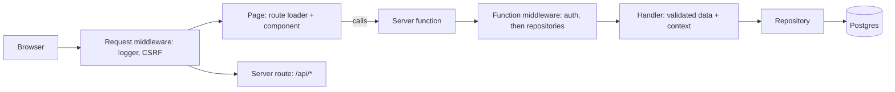
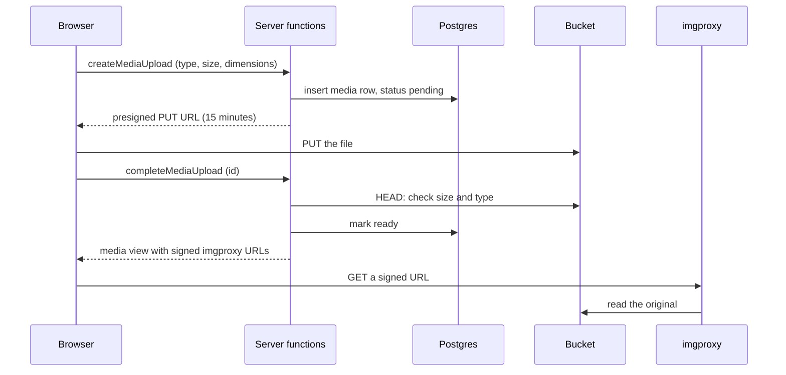

# dqc-main

The Digital Queer Collective's site (dqc.dev): who the collective is, its team and projects, and its writing ("thoughts" and statements), plus a contact form. Admins sign in with DQC's own sign-in service to reach `/dashboard`, where they write and publish all of it.

The app follows the same structure as [devsharpe](https://github.com/devinsharpe/devsharpe), and code is copied between the two. Its README explains the patterns in more depth.

- [Stack](#stack)
- [Getting started](#getting-started)
- [Scripts](#scripts)
- [Environment](#environment)
- [Project layout](#project-layout)
- [How a request flows](#how-a-request-flows)
- [Authentication](#authentication)
- [Contact form](#contact-form)
- [Admin pages](#admin-pages)
- [Content](#content)
- [Migrations](#migrations)
- [Deploying](#deploying)

## Stack

| Concern    | Choice                                                                                                                                                   |
| ---------- | -------------------------------------------------------------------------------------------------------------------------------------------------------- |
| Framework  | [TanStack Start](https://tanstack.com/start) (React 19, TanStack Router file routes, server functions), built with Vite and Nitro (`node-server` preset) |
| Database   | Postgres, with [Drizzle ORM](https://orm.drizzle.team) (1.0 RC) and drizzle-kit migrations                                                               |
| Validation | Zod 4, shared by forms and server functions                                                                                                              |
| Forms      | TanStack Form (`@tanstack/react-form-start`)                                                                                                             |
| Rich text  | [Lexical](https://lexical.dev), stored as its JSON editor state                                                                                          |
| Auth       | [Better Auth](https://better-auth.com) with a generic OAuth provider (DQC's sign-in service)                                                             |
| Media      | Any S3-compatible bucket (RustFS locally), rendered through [imgproxy](https://imgproxy.net)                                                             |
| Styling    | Tailwind CSS v4 and `@tailwindcss/typography`                                                                                                            |
| Bot check  | Cloudflare Turnstile on the contact form                                                                                                                 |
| Mail       | Resend, for people who opt in to communications on the contact form                                                                                      |
| Analytics  | Plausible (self-hosted), loaded from the root route                                                                                                      |

## Getting started

The local stack runs in Docker Compose: the app, Postgres, RustFS (S3-compatible storage) and imgproxy.

```sh
cp .env.example .env    # then fill in BETTER_AUTH_SECRET and the DQC_* values
docker compose up
```

Open <http://localhost:3000>. Each time the app container starts, [`docker/dev-entrypoint.sh`](docker/dev-entrypoint.sh):

1. Runs `npm ci` if `package-lock.json` changed since the last install. `node_modules` is a Docker volume, so the Linux builds stay separate from the host's.
2. Creates the media bucket and its CORS rules ([`docker/setup-bucket.mjs`](docker/setup-bucket.mjs)).
3. Applies pending migrations (`npm run migrate`).
4. Starts the Vite dev server. The source is bind-mounted, so edits hot-reload.

Compose sets `DATABASE_URL` and every `S3_*` and `IMGPROXY_*` value itself; everything else comes from `.env`. Sign in at `/login` to reach `/dashboard`.

| Service        | URL                                                             | Move it with      |
| -------------- | --------------------------------------------------------------- | ----------------- |
| App            | <http://localhost:3000>                                         | (fixed)           |
| Postgres       | `localhost:5432` (user, password and database are all `dqc`)    | `POSTGRES_PORT`   |
| S3 API         | <http://localhost:9000>                                         | `S3_PORT`         |
| RustFS console | <http://localhost:9001> (user `dqc`, password `dqc-dev-secret`) | `S3_CONSOLE_PORT` |
| imgproxy       | <http://localhost:8080>                                         | `IMGPROXY_PORT`   |

`docker compose down -v` deletes the database, the uploaded files and the installed `node_modules`.

To run the dev server on the host instead, start the other services with `docker compose up postgres rustfs imgproxy`, then run `npm install`, `npm run migrate` and `npm run dev`. `.env.example`'s `DATABASE_URL` already points at the database. For media, copy the `S3_*` and `IMGPROXY_*` values from the app service in [`compose.yaml`](compose.yaml) into `.env`, with `S3_ENDPOINT=http://localhost:9000` and no `S3_PUBLIC_ENDPOINT`, and run `node --env-file=.env docker/setup-bucket.mjs` once.

## Scripts

| Script                  | What it does                                                                                                                      |
| ----------------------- | --------------------------------------------------------------------------------------------------------------------------------- |
| `npm run dev`           | Vite dev server on port 3000                                                                                                      |
| `npm run build`         | Production build to `.output/`: the server, plus a self-contained build of the start-up scripts in `.output/tools`                |
| `npm start`             | Runs the production build (`node .output/server/index.mjs`). The Docker image runs migrations first; see [Deploying](#deploying). |
| `npm run typecheck`     | `tsc --noEmit`. There are no tests yet, so this is the check to run.                                                              |
| `npm run gen-migration` | Generates a migration in `drizzle/` from changes to the schema                                                                    |
| `npm run migrate`       | Applies pending migrations to `DATABASE_URL`                                                                                      |
| `npm run check`         | Biome: formatting and lint                                                                                                        |

Inside Docker, prefix any of these with `docker compose exec app`.

## Environment

See [`.env.example`](.env.example) for every variable, with comments. Server code reads them through `getServerEnv()` in [`src/server/env.server.ts`](src/server/env.server.ts), on each call and never at module scope. Nothing is built into the client bundle, so the image builds without any of them.

| Variables                                                                                                                        | Used for                                                                             | Without them                                                           |
| -------------------------------------------------------------------------------------------------------------------------------- | ------------------------------------------------------------------------------------ | ---------------------------------------------------------------------- |
| `DATABASE_URL`                                                                                                                   | Postgres                                                                             | Nothing works                                                          |
| `BETTER_AUTH_URL`, `BETTER_AUTH_SECRET`                                                                                          | Sessions and the OAuth callback                                                      | Sign-in fails                                                          |
| `DQC_CLIENT_ID`, `DQC_CLIENT_SECRET`, `DQC_AUTHORIZE_URL`, `DQC_TOKEN_URL`, `DQC_USER_INFO_URL`, `DQC_END_SESSION_URL`           | The OAuth provider                                                                   | Sign-in fails                                                          |
| `VITE_CLOUDFLARE_SITEKEY`, `CLOUDFLARE_SECRET_KEY`                                                                               | Turnstile on the contact form                                                        | The contact form is switched off                                       |
| `RESEND_SECRET_KEY`                                                                                                              | The contact form's mail opt-in                                                       | Messages are still saved, but people who opt in aren't added to Resend |
| `S3_BUCKET`, `S3_REGION`, `S3_ENDPOINT`, `S3_PUBLIC_ENDPOINT`, `S3_FORCE_PATH_STYLE`, `S3_ACCESS_KEY_ID`, `S3_SECRET_ACCESS_KEY` | Media uploads                                                                        | Uploads are switched off, and the media library says what's missing    |
| `S3_CORS_ORIGINS`                                                                                                                | Optional: origins allowed to upload, applied to the bucket when the container starts | The bucket's CORS rules are left alone                                 |
| `IMGPROXY_URL`, `IMGPROXY_KEY`, `IMGPROXY_SALT`, `IMGPROXY_SOURCE_PREFIX`                                                        | Showing images                                                                       | Images are left out of pages                                           |

## Project layout

```text
.
├── .gitea/workflows/         Builds the production image, pushes it to the registry, tells Dokploy
├── Dockerfile                Production image (see Deploying)
├── compose.yaml              Local stack: app, postgres, rustfs, imgproxy
├── docker/                   Dev entrypoint, production start script, its build config and package.json
├── drizzle/                  Generated SQL migrations (one folder each)
├── drizzle.config.ts         drizzle-kit: schema path, output folder
├── vite.config.ts            TanStack Start + Nitro + Tailwind + React
└── src/
    ├── start.ts              Request middleware: logging, CSRF
    ├── router.tsx            Router defaults
    ├── routeTree.gen.ts      Generated by the router plugin; don't edit
    ├── routes/               File-based routes: pages and server routes
    │   ├── __root.tsx        Document shell, header/footer, <head>
    │   ├── _authenticated.tsx  Sign-in guard for the admin pages
    │   ├── _authenticated/   Admin: /dashboard and its requests, posts, projects, team and media pages
    │   ├── thoughts/, statements/, projects/  Published content (see Content)
    │   └── api/              Server routes: auth, health
    ├── components/           _ui/ holds the primitives (Button, Dialog, AlertDialog, Toast, form fields, …)
    │   ├── forms/            Admin forms, built with useAppForm (src/forms/context.form.ts)
    │   ├── media/            The media library: tiles, uploader, details dialog, picker
    │   └── rich-text/        The Lexical editor, its toolbar, and the renderer for published pages
    ├── lib/                  Client-safe: constants, Zod schemas, pure helpers
    ├── server/               Server-only code
    │   ├── functions/        Server functions (*.functions.ts): the app's API
    │   ├── middleware/       Function middleware (*.middleware.ts): auth, repositories
    │   ├── repositories/     Database access, one class per table (*.repository.server.ts)
    │   ├── database/         Drizzle client, schema, relations, migrator
    │   ├── media/            The bucket, imgproxy URLs, and media as pages see it
    │   ├── auth.server.ts    Better Auth instance
    │   ├── resend.server.ts  Adds people who opt in to Resend's contacts
    │   ├── turnstile.server.ts  Checks Turnstile tokens with Cloudflare
    │   └── env.server.ts     Environment access
    └── styles/
```

## How a request flows



- **Request middleware** ([`src/start.ts`](src/start.ts)) wraps everything the server handles. `requestLogger` logs `[id] METHOD /path 12ms` and sets an `x-request-id` header. `createCsrfMiddleware` guards server function calls.
- **Server functions** are the app's only API for pages. Each one declares its middleware (auth first for admin functions, then the repositories it needs in `context`) and a Zod validator, then calls into a repository.
- **Server routes** handle raw HTTP that isn't page data: the Better Auth handler and `/api/health`.

## Authentication

[`src/server/auth.server.ts`](src/server/auth.server.ts) configures Better Auth with the Drizzle adapter and one generic OAuth provider, `dqc`, whose endpoints come from the `DQC_*` variables. `/login` calls `auth_client.signIn.social({ provider: "dqc" })`, and `/api/auth/$` handles the callback.

- **Pages.** [`_authenticated.tsx`](src/routes/_authenticated.tsx) checks the session in `beforeLoad` and redirects to `/login?redirect=…` without one. After signing in, `/login` sends you back there (only to paths on this site), or to `/dashboard`. Everything under `src/routes/_authenticated/` is behind it.
- **Data.** Each admin server function uses `ensure_auth_middleware` from [`auth.middleware.ts`](src/server/middleware/auth.middleware.ts). The route guard only hides pages, so the middleware is what actually protects the data.
- **Who's an admin.** Any signed-in session counts. Who can sign in is decided by the dqc-main application's settings in DQC's sign-in service, not by this app.
- **Signing out** (the footer's button) ends the session here and at the provider (`DQC_END_SESSION_URL`), then comes back to `/`. The footer's 🏳️‍🌈 is the way in to `/login`.

## Contact form

The contact form is the first feature built on this pattern, so it's a good one to copy from:

- **Schemas** live in [`src/lib/contact.ts`](src/lib/contact.ts), shared by the form and the server functions.
- **Server functions** are in [`contact.functions.ts`](src/server/functions/contact.functions.ts). The public ones are `getContactForm` (the home page's loader, which hands out the Turnstile site key) and `submitContactRequest`. The admin ones list requests, mark them read or new, and delete them.
- **Middleware and repository:** [`contact.middleware.ts`](src/server/middleware/contact.middleware.ts) puts a [`ContactRequestRepository`](src/server/repositories/contact-request.repository.server.ts) in `context`.

Sending a message:

1. The [`Turnstile`](src/components/Turnstile.tsx) widget loads Cloudflare's script when the form renders, then hands the form a token. The form lives on the home page, inside a closed dialog, so only the home page loads the script.
2. `submitContactRequest` checks the token with [`turnstile.server.ts`](src/server/turnstile.server.ts). It answers 400 if Cloudflare rejects the token, and 503 if Cloudflare can't be reached. The form resets the widget after every attempt, since each token works only once.
3. If the person opted in, [`resend.server.ts`](src/server/resend.server.ts) adds them to Resend's contacts.
4. The message is saved. It's saved even when the Resend step fails: the failure is logged, and the request is stored with consent but no `communications_id`.

Each request has a `read_at` column: null while it's new, and set when an admin first marks it read. Marking it new again clears it.

## Admin pages

Everything under `src/routes/_authenticated/` needs a session (see [Authentication](#authentication)):

- **`/dashboard`:** the three newest contact requests, the three most recently edited posts, the first three active projects, and the team.
- **`/dashboard/requests`:** the inbox. New requests come first, then read ones 20 to a page. Each can be answered by email, marked read or new, or deleted.
- **`/dashboard/posts`:** thoughts and statements, drafts first. New posts start as drafts; **`/dashboard/posts/$postId`** is where they're written and published.
- **`/dashboard/projects`:** active and past projects, each in the order it's listed on the site (drag a row's handle, or focus it and use the arrow keys). **`/dashboard/projects/$projectId`** writes the project's page.
- **`/dashboard/team`:** the people on the About page, in order, the same way. **`/dashboard/team/$memberId`** writes their bio.
- **`/dashboard/media`:** the media library (see [Media](#media)). Upload images, filter them by tag, and edit each one's alt text, caption and tags. Deleting an image lists the pages that use it first.

The admin layout wraps its pages in an `AlertDialogProvider`, so any of them can ask before doing something that can't be undone:

```tsx
const confirm = useConfirm();
if (!(await confirm({ title: "Delete it?", confirm_label: "Delete", is_destructive: true }))) return;
```

New admin pages start with a [`BreadcrumbNav`](src/components/_ui/BreadcrumbNav.tsx). After a change, they call `router.invalidate()` to reload their loader data, and report the result with a toast, as [`ContactRequestItem`](src/components/ContactRequestItem.tsx) does. A loader that throws shows [`ErrorView`](src/components/_ui/ErrorView.tsx) with the error's message, so write those messages for the person reading them.

## Content

Thoughts, statements, projects and the team's bios live in Postgres and are edited from the admin pages. Nothing on the public pages is written into the code any more.

| Content    | Table                       | Public page                                                                               |
| ---------- | --------------------------- | ----------------------------------------------------------------------------------------- |
| Thoughts   | `post` (`kind` `thought`)   | Listed on `/thoughts`, each at `/thoughts/$slug`                                          |
| Statements | `post` (`kind` `statement`) | Each at `/statements/$slug` (not listed; link to them, e.g. from About)                   |
| Projects   | `project`, `project_page`   | Listed on `/projects` (and the first three active ones on `/`), page at `/projects/$slug` |
| Team       | `team_member`               | "Our Team" on `/about`                                                                    |

**Drafts and publishing.** Each piece of rich text has a draft and a published copy (`draft_content` and `published_content`). Saving (⌘/Ctrl+S) only changes the draft; Publish copies it to the live page in the same write, and Unpublish takes the page down but keeps the draft. Public server functions only ever read the published copy, so a draft is never sent to a visitor. A post's date (`published_at`) is set the first time it's published; publishing changes later sets `revised_at`, and its page shows "Updated" from a different day on. A project without a published page is still listed on `/projects`, just without a link; its `/projects/$slug` is a 404. Someone on the team appears on `/about` once their bio is published.

**Rich text** is stored as Lexical's JSON (see [`src/lib/rich-text.ts`](src/lib/rich-text.ts)). The editor ([`components/rich-text/`](src/components/rich-text)) is client-only and loaded only on the editor pages. Public pages render the JSON with [`RichTextRenderer`](src/components/rich-text/RichTextRenderer.tsx), which doesn't use Lexical. It renders only the node types it knows, shows unsafe links (anything but http(s), `mailto:` and paths on this site) as plain text, and opens other sites' links in a new tab. Page titles are h2s (the site name in the header is the h1), so documents use h3 and h4: `##` in the editor makes a heading and `###` a subheading, and the renderer folds any other level into those. There are no images in rich text yet.

**Slugs** follow the title (or name) as you type until you change them by hand. A post's slug and kind can change, which changes its URL; a published post warns about that. A project's slug is its id, fixed once it's created.

The content that was written into the pages before (the 2026 thought, the three statements as empty drafts, the Trans Formations Data Archive and its page, and both bios) moved into these tables in the `content_seed` migration, so a new database starts with it. Edit it from the admin pages, not by changing that migration.

## Media

Images go straight from the browser to the bucket. The server never handles the file itself.



- **Object keys.** The server generates keys (`media/{id}.{ext}`), never from the file name. An upload whose size or type doesn't match what was declared is deleted.
- **Abandoned uploads.** A row still pending after 24 hours is removed, with its object, the next time something is uploaded.
- **The bucket stays private.** Browsers upload with presigned URLs and imgproxy reads with its own credentials. imgproxy URLs are signed with `IMGPROXY_KEY` and `IMGPROXY_SALT` on the server ([`imgproxy.server.ts`](src/server/media/imgproxy.server.ts)), so only this server can ask for an image, or a size of one.
- **Responsive images.** [`media-views.server.ts`](src/server/media/media-views.server.ts) turns rows into `src` and `srcSet` at 640, 1280, 1920 and 2560px, skipping widths larger than the original, plus a 480px thumbnail for the library.
- **Without the services.** With no bucket configured, uploads are switched off; without imgproxy, the library shows file names instead of previews. The media page says which variables are missing.

## Migrations

1. Change [`schema.server.ts`](src/server/database/schema.server.ts).
2. Run `npm run gen-migration`, which writes `drizzle/<timestamp>_<name>/migration.sql` and a snapshot.
3. Read the generated SQL, especially for renames, which drizzle-kit may treat as a drop and an add.
4. Apply it with `docker compose exec app npm run migrate`, or restart the app container.

Data changes that every environment needs, like `content_seed`, go in a migration of their own: `npx drizzle-kit generate --custom --name <name>` makes an empty one to write SQL into. Keep each statement separated with `--> statement-breakpoint`.

drizzle-kit and the production image's migrator (drizzle-orm's own, see [Deploying](#deploying)) record what they've applied in the same table, `drizzle.__drizzle_migrations`, so either can follow the other. The first migration, `20260324232124_odd_titania`, was converted from drizzle-kit 0.31's format with `drizzle-kit up`. Databases that 0.31 migrated recognise it as already applied.

## Deploying

Production runs the image built from the [`Dockerfile`](Dockerfile). A Gitea Actions runner builds it and pushes it to the Gitea container registry, and Dokploy pulls it from there, so builds don't take resources from the server the site runs on.

**The image.** The build stage runs `npm ci` and `npm run build` on `node:26-trixie-slim`. The runtime image takes only three things from it:

- the built server (`.output/server`), with its dependencies bundled in
- the start-up scripts (`.output/tools`), bundled the same way by [`docker/vite.tools.config.mjs`](docker/vite.tools.config.mjs)
- the migrations' SQL (`drizzle/`)

The runtime base is `node:26-trixie-slim` too, so the container has `bash` and `npm` for debugging, for example in Dokploy's terminal. It has no `node_modules`, so its `package.json` is [`docker/runtime.package.json`](docker/runtime.package.json), whose `npm run migrate` runs the bundled migrator. It runs as the base image's non-root `node` user, and the app's files stay owned by root.

**Each time the container starts**, [`docker/start.mjs`](docker/start.mjs) does the following, all in the one Node process:

1. Applies pending migrations with [`migrate.server.ts`](src/server/database/migrate.server.ts). If they fail, for example because the database is unreachable, the container exits with an error instead of serving on an old schema.
2. If `S3_CORS_ORIGINS` is set, runs [`docker/setup-bucket.mjs`](docker/setup-bucket.mjs). It creates the bucket if it's missing and **replaces** its CORS rules with one that lets those origins upload. Leave `S3_CORS_ORIGINS` unset to manage the bucket's CORS yourself.
3. Starts the server on port 3000.

**Health check.** The image's `HEALTHCHECK` requests `GET /api/health` every 30 seconds, after a 60-second start period that covers the migrations. It runs the request with Node, since the image has no `curl`.

### Building on a runner

[`.gitea/workflows/build-image.yml`](.gitea/workflows/build-image.yml) runs on each push to `main`, and by hand from the repository's Actions tab. It builds the image for `linux/amd64` and `linux/arm64`, then pushes it as `gitea.dqc.dev/<owner>/<repository>`, tagged with the short commit hash and `latest`. If `DOKPLOY_WEBHOOK_URL` is set, it then tells Dokploy to deploy.

It needs these repository secrets (Settings → Actions → Secrets):

| Secret                | Value                                                                   |
| --------------------- | ----------------------------------------------------------------------- |
| `REGISTRY_USERNAME`   | A Gitea user that can write the repository's packages                   |
| `REGISTRY_PASSWORD`   | An access token for that user, with package read and write              |
| `DOKPLOY_WEBHOOK_URL` | Optional: the application's deploy webhook URL from Dokploy (see below) |

**Cloudflare's upload limit.** The registry is behind Cloudflare, which rejects any request over 100 MB. A push uploads each layer in its own request, so each layer must fit. The largest here is the base image's Node and npm. Copying `node_modules` into the runtime image, or exporting the build cache with `--cache-to type=registry,mode=max`, would break that.

### Setting it up in Dokploy

1. Add the Gitea registry under Dokploy's registry settings: URL `https://gitea.dqc.dev`, and a user and token that can read the package. Or give the credentials in the application's Docker settings.
2. Set the application's source to **Docker**, with the image `gitea.dqc.dev/<owner>/<repository>:latest`. Include the registry host: without it, Docker looks for the image on Docker Hub.
3. Turn on Auto Deploy, then copy the application's webhook URL into the repository secret `DOKPLOY_WEBHOOK_URL`. Check the first deploy's log to confirm that Dokploy pulls `latest` again.
4. Add the environment variables below.
5. Point the site's domain at container port **3000**, with HTTPS.

Building from the repository in Dokploy (the **Dockerfile** build type) also works, but use one or the other, or each push deploys twice.

### Services it needs

- **Postgres**. Development uses version 18.
- **An S3-compatible bucket**, kept private. Browsers upload straight to it with presigned URLs, so it must be reachable from the browser at `S3_PUBLIC_ENDPOINT` (when that differs from `S3_ENDPOINT`). It also needs a CORS rule allowing `PUT` from the site, set by `S3_CORS_ORIGINS` or by hand.
- **imgproxy**, reachable from the browser at `IMGPROXY_URL`, since pages load images from it. It must use the same key and salt as the app and be able to read the bucket. The `imgproxy` service in [`compose.yaml`](compose.yaml) shows the settings it needs: `IMGPROXY_USE_S3`, the S3 endpoint and credentials, and `IMGPROXY_ALLOWED_SOURCES`.

The site runs without the bucket and imgproxy: uploads are switched off and pages leave images out.

### Production environment

| Variables                                                                 | Value                                                                                                                       |
| ------------------------------------------------------------------------- | --------------------------------------------------------------------------------------------------------------------------- |
| `NODE_ENV`, `PORT`                                                        | Set by the image (`production`, `3000`)                                                                                     |
| `DATABASE_URL`                                                            | The production database                                                                                                     |
| `BETTER_AUTH_URL`                                                         | The public origin, e.g. `https://dqc.dev`. Session cookies are marked secure, and the OAuth redirect URI is built, from it. |
| `BETTER_AUTH_SECRET`                                                      | A long random value, e.g. `openssl rand -base64 32`                                                                         |
| `DQC_*`                                                                   | The dqc-main sign-in application's client and endpoints. Add `https://<domain>/api/auth/callback/dqc` to its redirect URIs. |
| `VITE_CLOUDFLARE_SITEKEY`, `CLOUDFLARE_SECRET_KEY`                        | A real Turnstile widget's keys, with the domain in its hostnames. Both are read when the server runs, not at build time.    |
| `RESEND_SECRET_KEY`                                                       | Resend's API key                                                                                                            |
| `S3_*`                                                                    | The production bucket and its credentials. `S3_CORS_ORIGINS` (e.g. `https://dqc.dev`) is optional.                          |
| `IMGPROXY_URL`, `IMGPROXY_KEY`, `IMGPROXY_SALT`, `IMGPROXY_SOURCE_PREFIX` | The public imgproxy URL, and a key and salt that match its own                                                              |

Never reuse the fixed development values from `compose.yaml` (the bucket's keys, imgproxy's key and salt) in production.

### Trying the image locally

```sh
docker build -t dqc-main .
docker run --rm -p 3000:3000 --env-file .env.production dqc-main
```

`.env.*` files are ignored by git and Docker, so the file's secrets stay out of commits and images. Its addresses must be reachable from inside the container, where `localhost` is the container itself. Use the other containers' names on a shared Docker network, or `host.docker.internal` to reach the host.
